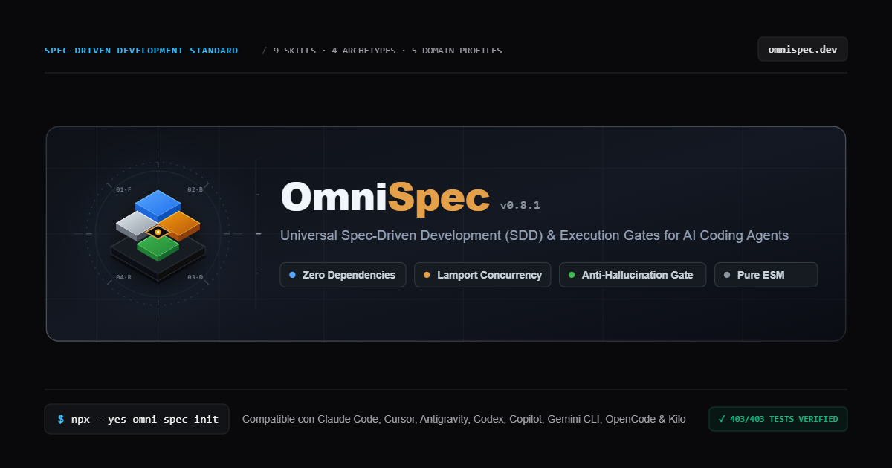

<p align="center">
  <a href="https://omnispec.dev">
    
  </a>
</p>

<h1 align="center">OmniPage</h1>

<p align="center">
  Sitio oficial y documentación de <a href="https://github.com/brahiandres1999-oss/omni-spec"><strong>OmniSpec</strong></a>.<br>
  <a href="https://omnispec.dev"><strong>omnispec.dev</strong></a> ·
  <a href="https://omnispec.dev/docs/">Documentación</a> ·
  <a href="https://omnispec.dev/changelog/">Changelog</a> ·
  <a href="https://www.npmjs.com/package/omni-spec">npm</a>
</p>

---

## ¿Qué es esto?

Este repositorio contiene **solo el sitio web** de OmniSpec. La herramienta (CLI, skills y runtime) vive en [`brahiandres1999-oss/omni-spec`](https://github.com/brahiandres1999-oss/omni-spec).

**OmniSpec** lleva *Spec-Driven Development* a tu agente de IA (Claude Code, Codex, Cursor, Copilot, Gemini CLI, Antigravity, Kilo, OpenCode): cada cambio pasa por una especificación, un plan y una verificación con evidencia, en lugar de un chat improvisado. Para probarlo:

```bash
npx --yes omni-spec init
```

## El sitio

| Ruta | Contenido |
|---|---|
| [`/`](https://omnispec.dev) | Propuesta de valor, terminal interactiva de instalación, comparativa chat vs. OmniSpec, las 9 skills, rutas *Spec Fit* con los 4 arquetipos, instalación por agente y FAQ. |
| [`/docs/`](https://omnispec.dev/docs/) | Guía completa: arquitectura, contratos, ciclo de vida y comandos del CLI. |
| [`/changelog/`](https://omnispec.dev/changelog/) | Notas de cada versión publicada. |

- Bilingüe **español / inglés** y tema **claro / oscuro**, recordados en el navegador.
- HTML estático, sin frameworks de cliente; JavaScript mínimo y solo donde hay interacción.
- Navegación por teclado, `prefers-reduced-motion` y diseño responsive desde 320 px.
- SEO: URLs canónicas, Open Graph/Twitter con imagen 1200×630, JSON-LD (`SoftwareApplication`, `FAQPage`), `robots.txt` y `sitemap.xml` generados en el build.

## Stack

[Astro 4](https://astro.build) · [Tailwind CSS 3](https://tailwindcss.com) · TypeScript · tests con `node:test`.

## Desarrollo local

Requiere Node.js 20 o superior.

```bash
npm install
npm run dev       # servidor local en http://localhost:4321
npm run build     # astro check + build de producción en dist/
npm test          # contratos del sitio (requiere build previo)
npm run preview   # sirve dist/ localmente
```

`npm test` valida sobre `dist/`: enlaces y anclas internas, claves de traducción en ambos idiomas, un solo `<h1>` por página, assets existentes, contenido de las 9 skills y de la última versión, y los artefactos SEO.

## Estructura

```
src/
├── pages/          # index, docs, changelog, robots.txt y sitemap.xml
├── layouts/        # Layout.astro: <head>, metadatos SEO y JSON-LD
├── components/     # Hero, ProductCanvas, ChaosVsSpec, AgentSelector, FAQ…
├── data/           # Fuente de verdad del contenido (ver abajo)
├── i18n/           # translations.ts: textos ES/EN
├── scripts/        # preferences.ts: idioma y tema
└── styles/         # global.css
public/assets/      # Imagen social, logos de agentes y favicon
tests/              # site.test.mjs
```

## Actualizar el contenido para una nueva versión de OmniSpec

1. **`src/data/omnispec.ts`**: versión, comandos de instalación y datos de cada agente.
2. **`src/data/releases.json`**: añade la entrada nueva al inicio (fecha, título, descripción y puntos clave en ES/EN). El `sitemap.xml` toma de aquí la fecha `lastmod`.
3. **`src/data/docs.ts`** y **`src/i18n/translations.ts`**: textos de documentación y de la landing si cambian.
4. `npm run build && npm test` y push a `main`.

## Despliegue

Cada push a `main` ejecuta [`.github/workflows/deploy.yml`](.github/workflows/deploy.yml), que compila el sitio y lo publica en **GitHub Pages**. El dominio `omnispec.dev` (DNS en Cloudflare) apunta a GitHub Pages.

`astro.config.mjs` compila para `https://omnispec.dev` en la raíz (`/`). Para otro destino se pueden usar las variables `SITE_URL` y `BASE_PATH`.

## Créditos

Los logos de agentes pertenecen a sus respectivos dueños y solo identifican herramientas compatibles; sus fuentes y licencias están en [`public/assets/agents/`](public/assets/agents/).

Hecho por [Brahian Ospina](https://github.com/brahiandres1999-oss).
